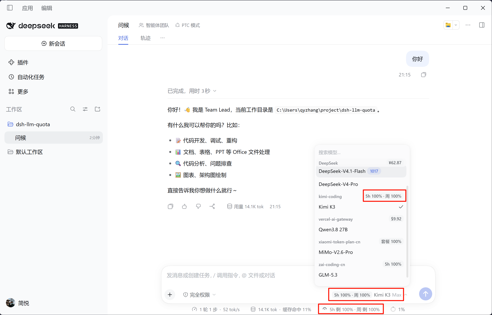
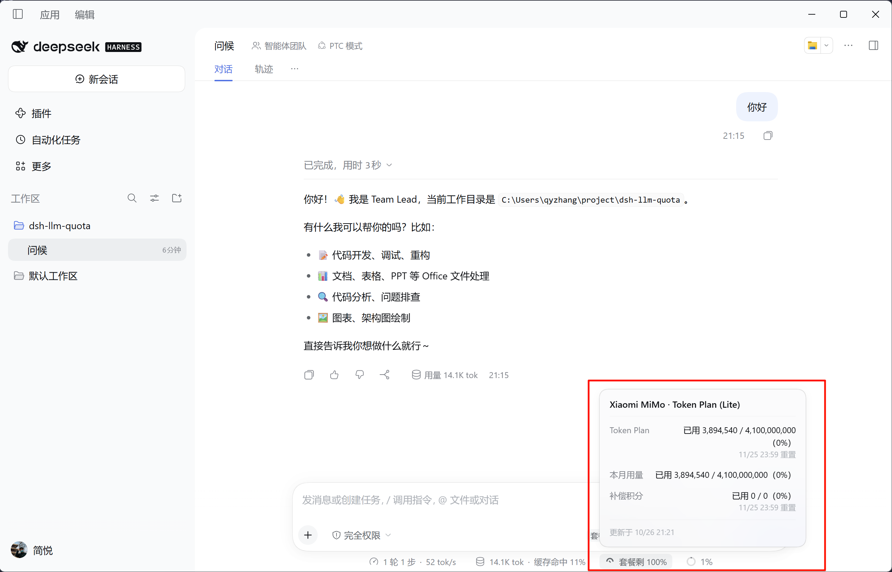

# dsh-llm-quota

[](https://www.npmjs.com/package/@cs-qyzhang/dsh-llm-quota)
[](LICENSE)
[](https://github.com/deepseek-ai/deepseek-harness)

在 DeepSeek Harness（dsh）的状态行与模型选择器中，实时显示当前模型供应商的剩余余额或 Coding Plan 额度——不用切回控制台，写代码时随时掌握额度还剩多少。

## 特性

- **状态行实时展示**：余额型显示剩余金额，套餐型显示 5 小时 / 周额度百分比与重置时间
- **多供应商支持**：覆盖 DeepSeek、GLM、Kimi、MiniMax、Moonshot、OpenRouter、Anthropic、OpenAI、GitHub Copilot、Cloudflare、Vercel、Qwen、Xiaomi MiMo 等主流服务
- **详情浮层**：点击状态行条目即可展开充值余额、套餐等级、重置时间等明细
- **凭证安全**：控制台凭证通过 Host 的凭据库存储，浏览器只能读到「已配置 / 未配置」，接触不到明文
- **可扩展**：支持自定义 provider 路由与适配器配置，便于接入代理或私有部署

## 界面预览

状态行、模型菜单与「当前模型」标签中的额度：



点击状态行条目展开的详情浮层：



## 安装/更新

插件已发布至 npm：[`@cs-qyzhang/dsh-llm-quota`](https://www.npmjs.com/package/@cs-qyzhang/dsh-llm-quota)，推荐通过 `dsh plugin` 从 npmjs 安装。

### 命令行安装

```bash
dsh plugin --profile web add @cs-qyzhang/dsh-llm-quota@latest
```

### 通过 Plugins 页

1. 打开 dsh 页面上方的 **插件** -> **添加插件**。
2. 填写 `@cs-qyzhang/dsh-llm-quota`，点击安装并启用。

### 卸载

```bash
dsh plugin --profile web remove @cs-qyzhang/dsh-llm-quota
```

移除后重启 dsh 或刷新页面即可，`dsh plugin` 会同时清理 `dsh.profile.bundles` 中的对应条目。

## 支持的供应商

| 供应商 | provider id 示例 | 状态行 | 点击展开 |
| --- | --- | --- | --- |
| DeepSeek 账号 | `deepseek-account` | `余额 ¥65.28` | 充值余额、赠送余额、更新时间 |
| DeepSeek API Key | `deepseek-official` | `余额 ¥65.28` | 充值余额、赠送余额、可用状态 |
| Anthropic | `anthropic` | `本月已用 $12.34` | 本月已用、输入 / 输出 Tokens、更新时间 |
| Baseten | `baseten` | `本月已用 $12.34` | 本月已用、已用抵扣、实付小计、更新时间 |
| Cloudflare Workers AI / AI Gateway | `cloudflare-workers-ai`、`cloudflare-ai-gateway` | `余额 $95.50`，无余额时 `本月已用 $12.34` | 剩余额度、本期已用、更新时间 |
| Fireworks AI | `fireworks` | `本月已用 $12.34` | 本月已用、更新时间 |
| GitHub Copilot | `github-copilot` | `套餐剩 80%` | 套餐等级、Premium 请求、Chat 额度、重置时间 |
| GLM Coding Plan（Z.AI / 智谱） | `zai`、`zai-coding-cn` | `5h 剩 100% · 周 剩 33%` | 套餐等级、5 小时与周额度、重置时间 |
| Hugging Face | `huggingface` | `本月已用 $12.34`，无金额时 `本月已用 123 次` | 本月已用、请求数、输入 / 输出 Tokens、更新时间 |
| Kimi For Coding | `kimi-coding` | `5h 剩 0% · 周 剩 33%` | 5 小时与周额度、重置时间 |
| MiniMax Coding Plan / M Plan | `minimax`、`minimax-cn` | `5h 剩 83% · 周 剩 80%` | 模型名、5 小时与周额度、重置时间 |
| Moonshot 开放平台 | `moonshotai`、`moonshotai-cn` | `余额 ¥49.59` | 现金余额、代金券余额、更新时间 |
| OpenAI | `openai` | `本月已用 $12.34` | 本月已用、请求数、输入 / 输出 Tokens、更新时间 |
| OpenAI Codex（ChatGPT 订阅） | `openai-codex` | `5h 剩 80% · 周 剩 60%` | 5 小时与周额度、重置时间 |
| OpenCode Go | `opencode-go` | `5h 剩 80% · 周 剩 60%` | 5 小时 / 周 / 月额度、重置时间 |
| OpenRouter | `openrouter` | `余额 $15.50` | 已购买额度、已使用、更新时间 |
| Radius | `radius` | `余额 $45.00` | 本期已用、更新时间 |
| Together AI | `together` | `本月已用 $12.34` | 本月已用、更新时间 |
| Vercel AI Gateway | 指向 `ai-gateway.vercel.sh` 的路由，如 `vercel` | `余额 $95.50` | 剩余额度、已使用、更新时间 |
| xAI（Grok） | `xai` | `余额 $45.00` | 预付余额、本期已用、更新时间 |
| 阿里云百炼 Qwen Token Plan | `qwen-token-plan`、`qwen-token-plan-cn`、`qwen-token-plan-individual` | `套餐剩 50%` | 月度额度、重置时间 |
| Xiaomi MiMo（按量计费） | `xiaomi` | `余额 ¥65.27` | 现金/赠送/冻结余额、更新时间 |
| Xiaomi MiMo（Token Plan） | `xiaomi-token-plan-*` | `套餐剩 75%` | 套餐窗口、本月用量、重置时间 |
| 其它供应商 | — | 不显示 | — |

## 配置

### 控制台凭证

部分供应商的推理 Key 无查询额度权限，需要额外的控制台凭证。推荐在 **Plugins → Installed plugins → 模型额度** 的「供应商额外凭证」中填写：

| 字段 | 凭据引用 | 用途 |
| --- | --- | --- |
| Xiaomi MiMo 控制台 Cookie | `MIMO_COOKIE`（兼容 `XIAOMI_MIMO_COOKIE`） | `xiaomi` / `xiaomi-token-plan-*` 的余额与套餐额度 |
| Qwen 控制台 Access Token | `QWEN_CONSOLE_TOKEN`（兼容 `BAILIAN_CONSOLE_TOKEN`） | `qwen-token-plan*` 的 Token Plan 额度 |
| xAI Management Key | `XAI_MANAGEMENT_KEY`（兼容 `XAI_MANAGEMENT_API_KEY`） | `xai` 的预付余额与本期账单 |
| Anthropic / OpenAI Admin Key | `ANTHROPIC_ADMIN_KEY` / `OPENAI_ADMIN_KEY`（兼容 `ANTHROPIC_ADMIN_API_KEY` / `OPENAI_ADMIN_API_KEY`） | `anthropic` / `openai` 的本月已用 |
| GitHub Token | `COPILOT_GITHUB_TOKEN`（兼容 `GITHUB_TOKEN` / `GH_TOKEN` / `GITHUB_COPILOT_TOKEN`） | `github-copilot` 的 Premium 请求额度 |
| ChatGPT OAuth Token | `OPENAI_CODEX_TOKEN`（兼容 `OPENAI_CODEX_OAUTH_TOKEN` / `CHATGPT_OAUTH_TOKEN`） | `openai-codex` 的 5 小时 / 周额度 |
| ChatGPT Account ID | `OPENAI_CODEX_ACCOUNT_ID`（兼容 `CHATGPT_ACCOUNT_ID`） | `openai-codex` 查询所需的 `ChatGPT-Account-Id` |
| Cloudflare API Token | `CLOUDFLARE_API_TOKEN`（兼容 `CLOUDFLARE_API_KEY`） | `cloudflare` 的余额与本月已用 |
| Cloudflare Account ID | `CLOUDFLARE_ACCOUNT_ID` | `cloudflare` 查询所需的账户 ID |

也可以手动写入 `$DSH_HOME/.credentials.yaml` 的 `refs` 段（注意保留已有的 `records` 与其它 refs）：

```yaml
refs:
  XIAOMI_API_KEY: sk-...
  MIMO_COOKIE: "serviceToken=...; userId=..."
  QWEN_CONSOLE_TOKEN: "..."
  XAI_MANAGEMENT_KEY: "xai-..."
  ANTHROPIC_ADMIN_KEY: "sk-ant-admin-..."
  OPENAI_ADMIN_KEY: "sk-admin-..."
  COPILOT_GITHUB_TOKEN: "ghp-..."
  OPENAI_CODEX_TOKEN: "eyJ..."
  OPENAI_CODEX_ACCOUNT_ID: "account_..."
  CLOUDFLARE_API_TOKEN: "..."
  CLOUDFLARE_ACCOUNT_ID: "..."
```

**MiMo Cookie 获取方式**：登录 `platform.xiaomimimo.com`，从任意 `/api/v1/` 请求中复制完整的 `Cookie` 请求头，至少需包含 `serviceToken` 与 `userId`；Cookie 过期后重新复制即可。Qwen 控制台 token 可通过 `bl auth login --console` 获取，详见 [providers.md](docs/providers.md#阿里云百炼-qwen-token-plan)。xAI Management Key 在 console.x.ai → Settings → Management Keys 创建（只读、Team 作用域），不是推理 API Key，详见 [providers.md](docs/providers.md#xai预付余额)。Anthropic / OpenAI 的普通推理 Key 不能查询用量，需要 Console 创建的 Admin Key（`sk-ant-admin…` / `sk-admin…`，OpenAI 仅组织 Owner 可建）；GitHub Token 与 ChatGPT OAuth Token 分别用于 Copilot 与 Codex 的订阅额度（接口非公开、可能变动）；Cloudflare 需要带 AI Gateway Read / Billing Read 权限的**账户级 API Token** 加 Account ID，与推理用 Token 是两份凭证。详见 [providers.md](docs/providers.md#支持的额度体系)。

Moonshot 开放平台、MiniMax、OpenRouter、Vercel AI Gateway、Baseten、Fireworks AI、Together AI、Radius、Hugging Face、OpenCode Go 直接使用推理 Key，无需额外凭证。

### 高级覆盖

插件行支持可选的 `config`：

```yaml
- id: llm-quota
  name: '@cs-qyzhang/dsh-llm-quota'
  config:
    cacheSeconds: 30
    providers:
      my-glm-route:
        kind: glm
        endpoint: https://api.z.ai/api/monitor/usage/quota/limit
        keyNames: [MY_GLM_API_KEY]
      my-kimi-route:
        kind: kimi
        endpoint: https://api.kimi.com/coding/v1/usages
        keyNames: [MY_KIMI_KEY]
```

| 字段 | 默认值 | 说明 |
| --- | --- | --- |
| `cacheSeconds` | `30` | Host 侧每个配置指纹的成功结果缓存秒数 |
| `providers` | 自动解析 | 整体覆盖指定 provider 的适配器配置 |

`providers` 的值会整体替换该 provider 的自动解析结果。`kind` 必须是已注册适配器：`account`、`anthropic`、`baseten`、`cloudflare`、`deepseek`、`fireworks`、`github-copilot`、`glm`、`huggingface`、`kimi`、`minimax`、`moonshot`、`openai`、`openai-codex`、`opencode-go`、`openrouter`、`qwen`、`radius`、`together`、`vercel-gateway`、`xai`、`xiaomi-mimo`。

- 为 GLM / Kimi / MiniMax / Moonshot / OpenRouter / Vercel AI Gateway 自定义代理时，应同时填写 `endpoint` 和 `keyNames`。
- `qwen` 的 `endpoint` 是控制台 `cli/api.json` 的完整地址。
- `xiaomi-mimo` 的 `endpoint` 是控制台 API 基地址，`keyNames` 是 Cookie 凭据引用，`mode` 可选 `balance` 或 `plan`。

完整字段与示例见 [providers.md](docs/providers.md#自定义或增加-provider)。

## HTTP 接口

插件通过 DSH Host 暴露 `GET /api/llm-quota?provider=<provider id>`，返回对应供应商的余额或套餐额度 JSON：

```text
http://127.0.0.1:3090/api/llm-quota?provider=kimi-coding
```

```json
{
  "ok": true,
  "provider": "kimi-coding",
  "kind": "kimi",
  "fiveHour": { "usedPercent": 100, "remainingPercent": 0, "resetAt": "2026-10-24T11:30:21.000Z" },
  "weekly": { "usedPercent": 67, "remainingPercent": 33, "resetAt": "2026-10-30T02:30:21.000Z" },
  "updatedAt": "2026-10-24T10:34:25.655Z"
}
```

余额型供应商返回 `currency` / `amount` 等字段，套餐型返回 `fiveHour` / `weekly` 或 `plan`。请求需通过 dsh 登录认证。

## 故障排查

| 现象 | 检查 |
| --- | --- |
| 状态行没有额度条目 | 是否在已打开的会话中；当前 provider 是否受支持；新会话欢迎页不渲染 dock，可改看模型菜单或当前模型标签 |
| 模型菜单 / 当前模型旁没有额度 | 当前 provider 是否受支持；刷新页面；DSH 升级后确认 `data-provider-id` / `data-menu-group` 钩子仍在 |
| 显示「额度暂不可用」 | 请求对应 provider 的路由，查看返回的 `reason` / `error` |
| 显示「未配置 API Key」 | 对应凭证名是否在 dsh 凭证库或启动环境中 |
| 显示「未配置 MiMo 控制台 Cookie」 | 是否已配置 `MIMO_COOKIE`；Cookie 是否包含 `serviceToken` 与 `userId`；Cookie 是否过期 |
| 显示「未配置 Qwen 控制台 Token」 | 是否已配置 `QWEN_CONSOLE_TOKEN`；token 是否仍有效 |
| 显示「未配置 Admin Key」 | 是否已配置 `ANTHROPIC_ADMIN_KEY` / `OPENAI_ADMIN_KEY`；填的是 Admin Key（`sk-ant-admin…` / `sk-admin…`）而不是推理 Key |
| 显示「未配置 GitHub Token」 | 是否已配置 `COPILOT_GITHUB_TOKEN`（或 `GITHUB_TOKEN` / `GH_TOKEN` / `GITHUB_COPILOT_TOKEN`） |
| 显示「未配置 ChatGPT OAuth Token」 | 是否同时配置 `OPENAI_CODEX_TOKEN` 与 `OPENAI_CODEX_ACCOUNT_ID`；token 是否仍有效 |
| 显示「未配置 Cloudflare API Token 或 Account ID」 | 是否同时配置 `CLOUDFLARE_API_TOKEN` 与 `CLOUDFLARE_ACCOUNT_ID`；token 是否有 AI Gateway Read / Billing Read 权限 |
| 显示「请先登录 DeepSeek」 | DeepSeek 账号登录状态 |
| `slot entry crashed in 'conversation.composer.dock'` | 打开浏览器控制台检查 Client 插件异常；改完 `client.js` 后刷新页面 |
| 改了代码但页面没变化 | 客户端模块按文件 mtime/size 生成 revision；刷新页面，必要时重启 dsh |

## 开发

### 本地路径安装

本地开发时无需发布到 npm，直接用本地路径安装：

```bash
# 在仓库根目录执行
dsh plugin --profile web add .

# 或指定路径
dsh plugin --profile web add /path/to/dsh-llm-quota
```

- 本地安装写入的是同一条 `llm-quota` 插件行（`name` 取自 `package.json`），卸载命令不变：`dsh plugin --profile web remove @cs-qyzhang/dsh-llm-quota`。
- Host 侧 `index.js` 改动由 HMR / loader 重新加载，无 HMR 时重启 dsh；Client 侧 `client.js` 改动后刷新页面即可，详见 [architecture.md](docs/architecture.md#改动后的加载行为)。

### 语法检查与启动

```bash
# 语法检查与 Host 回归测试（不访问真实供应商）
npm run check
npm test

# 本地启动 dsh
dsh web
```

### 项目结构

```text
dsh-llm-quota/
├── package.json          # bundle 清单、dsh.client 配置、导出项
├── cordis.patch.yml      # 向 profile 插入 llm-quota 插件行
├── index.js              # Host：额度路由、缓存、错误归一化
├── providers/            # 供应商兼容层
│   ├── index.js          # 适配器注册表
│   ├── resolve.js        # DSH 实时配置 → 额度路由
│   ├── shared.js         # 凭证读取、上游 HTTP、响应工具
│   └── *.js              # account / deepseek / glm / kimi / minimax /
│                         # moonshot / openrouter / qwen / vercel-gateway / xiaomi-mimo
├── client.js             # Client：状态行、模型标签、轮询、浮层、配置页
├── locale/               # 插件管理页元数据（zh / en）
├── test/                 # Host 回归测试
├── docs/                 # 架构与供应商文档
├── icon.svg              # 插件图标
└── LICENSE
```

### 文档

| 文档 | 内容 |
| --- | --- |
| [docs/architecture.md](docs/architecture.md) | Host / Client 架构、slot 渲染、缓存、浮层与调试 |
| [docs/providers.md](docs/providers.md) | 各供应商接口、请求与响应解析、自定义 provider、接入新适配器 |
| [docs/dsh-providers.md](docs/dsh-providers.md) | dsh 全部三方模型 Provider，插件支持与不支持的清单及原因 |
| [docs/README.md](docs/README.md) | 文档索引 |

## License

[MIT](LICENSE)
