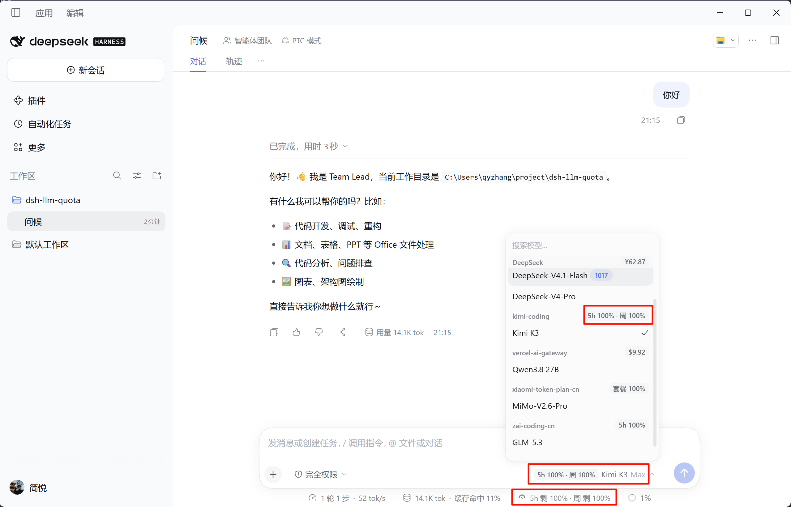
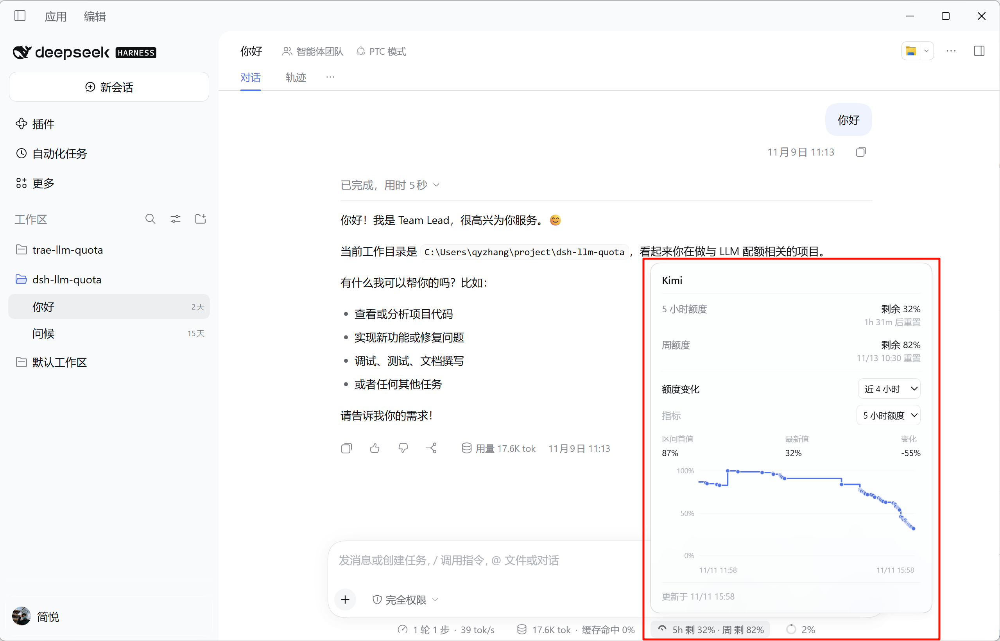

# dsh-llm-quota

[](https://www.npmjs.com/package/@cs-qyzhang/dsh-llm-quota)
[](LICENSE)
[](https://www.npmjs.com/package/@deepseek-ai/dsh)

在 DeepSeek Harness（dsh）的状态行与模型选择器中显示当前模型供应商的剩余余额或 Coding Plan 额度，并通过历史趋势图掌握额度变化。

Displays the current model provider's remaining balance or Coding Plan quota in the DeepSeek Harness (dsh) status line and model selector, with historical trend charts for tracking changes over time.

## 功能 / Features

- **实时额度**：显示余额、本月已用，或 5 小时 / 周额度的剩余百分比与重置时间。
- **多处展示**：覆盖状态行、模型菜单和「当前模型」标签，点击状态行可查看详情。
- **历史趋势**：后台定时采集，在详情浮层展示额度变化，无需保持会话页面打开。
- **多供应商**：支持 DeepSeek、GLM、Kimi、MiniMax、OpenAI、OpenRouter 等主流服务。
- **可扩展**：支持自定义 provider 路由和适配器配置，可接入代理或私有部署。

- **Real-time quotas**: Displays remaining balance, current month's usage, or the remaining percentage and reset time for 5-hour / weekly quotas.
- **Multiple locations**: Available in the status line, model menu, and “Current Model” label. Click the status line entry to view details.
- **Historical trends**: Collects data periodically in the background and displays changes in the detail popup, without keeping the session page open.
- **Multiple providers**: Supports DeepSeek, GLM, Kimi, MiniMax, OpenAI, OpenRouter, and other popular services.
- **Extensible**: Supports custom provider routes and adapter configurations for proxies or private deployments.

## 界面预览 / Preview





## 安装与更新 / Installation and Updates

要求 Node.js `>=22.13.0`。

Requires Node.js `>=22.13.0`.

```bash
dsh plugin --profile web add @cs-qyzhang/dsh-llm-quota@latest
```

也可以在 dsh 的 **插件 → 添加插件** 中填写 `@cs-qyzhang/dsh-llm-quota`，安装并启用。

Alternatively, enter `@cs-qyzhang/dsh-llm-quota` under **Plugins → Add Plugin** in dsh, then install and enable it.

卸载：

To uninstall:

```bash
dsh plugin --profile web remove @cs-qyzhang/dsh-llm-quota
```

卸载后重启 dsh 或刷新页面。

Restart dsh or refresh the page after uninstalling.

## 使用与配置 / Usage and Configuration

插件会根据当前模型的 provider 自动查询额度。完整的 provider ID、支持范围和凭证要求见[供应商文档](docs/providers.md#支持的额度体系)与 [DSH provider 清单](docs/dsh-providers.md)。

The plugin automatically queries quota based on the current model's provider. For complete provider IDs, supported scope, and credential requirements, see the [provider documentation](docs/providers.md#支持的额度体系) and [DSH provider list](docs/dsh-providers.md).

- **凭证**：默认复用 dsh 中已有的推理凭证。需要额外控制台凭证的供应商，可在 **Plugins → Installed plugins → 模型额度 → 供应商额外凭证** 中配置；各供应商的具体要求见[供应商文档](docs/providers.md)。
- **高级配置**：在 **Plugins → Installed plugins → 模型额度** 的「运行配置」中可调整 `cacheSeconds`、`history`、`historyDefaultRange`、`historyIntervalSeconds`，并用 JSON 编辑 `providers`；保存后立即生效。`historyDefaultRange` 控制历史浮层的初始范围，默认近 1 小时，可选近 1 / 4 / 12 / 24 小时、7 天或 30 天；保存后重新打开浮层生效。自定义路由字段与手工 YAML 示例见[自定义 provider](docs/providers.md#自定义或增加-provider)。
- **历史数据**：默认每 30 秒采集一次，仅在额度变化时写入本地 SQLite。存储路径、保留策略、抽样和趋势图说明见[架构文档](docs/architecture.md#历史采集与持久化)。

- **Credentials**: Reuses inference credentials already configured in dsh by default. For providers that require additional console credentials, configure them in the plugin's additional provider credentials section. See the [provider documentation](docs/providers.md) for provider-specific requirements.
- **Advanced configuration**: Under **Plugins → Installed plugins → Model quota**, the Runtime settings section exposes `cacheSeconds`, `history`, `historyDefaultRange`, `historyIntervalSeconds`, and a JSON editor for `providers`; changes apply immediately after saving. `historyDefaultRange` sets the initial history popup range: the last 1 hour by default, with options for the last 1 / 4 / 12 / 24 hours, 7 days, or 30 days. Reopen the popup after saving to apply it. See [custom providers](docs/providers.md#自定义或增加-provider) for route fields and manual YAML examples.
- **Historical data**: Collects data every 30 seconds by default and writes to local SQLite only when quota changes. See the [architecture documentation](docs/architecture.md#历史采集与持久化) for the storage path, retention policy, sampling, and trend charts.

## HTTP 接口 / HTTP API

```text
GET /api/llm-quota?provider=<provider id>
GET /api/llm-quota/history?provider=<provider id>&days=7
```

接口需要 dsh 登录认证。完整查询参数、响应示例和失败原因见[架构文档](docs/architecture.md#响应形状)。

Both endpoints require dsh authentication. See the [architecture documentation](docs/architecture.md#响应形状) for complete query parameters, response examples, and failure reasons.

## 故障排查与开发 / Troubleshooting and Development

常见错误及原因见[失败原因](docs/architecture.md#失败原因)，本地启动、浏览器验证和改动后的加载行为见[本地开发与验证](docs/architecture.md#本地开发与验证)。

For common errors and their causes, see [failure reasons](docs/architecture.md#失败原因). For local startup, browser verification, and reload behavior after changes, see [local development and verification](docs/architecture.md#本地开发与验证).

```bash
# 语法检查与 Host 回归测试（不访问真实供应商）
# Syntax checks and Host regression tests (no real provider requests)
npm run check
npm test
```

## 文档 / Documentation

| 文档 / Document | 内容 / Contents |
| --- | --- |
| [架构与实现 / Architecture and Implementation](docs/architecture.md) | Host / Client、缓存、历史存储、HTTP 接口、故障排查与开发验证<br>Host / Client, caching, history storage, HTTP API, troubleshooting, and development verification |
| [供应商适配 / Provider Integration](docs/providers.md) | 供应商接口、凭证、自定义 provider 与新适配器接入<br>Provider APIs, credentials, custom providers, and new adapter integration |
| [DSH provider 清单 / DSH Provider List](docs/dsh-providers.md) | dsh 三方模型 Provider 的支持清单与限制<br>Support status and limitations for third-party model providers in dsh |

## 许可证 / License

[MIT](LICENSE)
